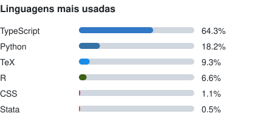
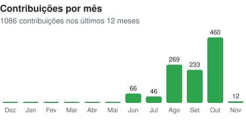

# Alisson Tallys Geraldo Fiorentin

Doutorando em Economia Aplicada na UFRGS. Mestre em Economia Aplicada pela FURG e bacharel em Matemática Aplicada.
Integro o Grupo de Pesquisa em Economia Azul (FURG). [ORCID](https://orcid.org/0009-0002-7233-3640) · [Site e artigos: econodados.vercel.app](https://econodados.vercel.app)

## Habilidades

- **Inferência causal:** DiD/TWFE, SDID, controle sintético, DDD com estudo de evento, Propensity Score Matching, Entropy Balancing
- **Painel e escolha discreta:** efeitos fixos, logit/probit, logit condicional de Chamberlain, erros-padrão HC3 e Driscoll-Kraay
- **Outros modelos:** fronteira estocástica (SFA), sobrevivência (Kaplan-Meier, Weibull), insumo-produto inter-regional, clusters e componentes principais
- **Risco climático:** metodologia DaLA, CLIMADA, análise custo-benefício
- **Dados e geoprocessamento:** ETL em Parquet, análise espacial, dashboards e WebGIS
- **Pesquisa reprodutível:** código e dados abertos, documentação e instruções de citação

## Ferramentas

<table>
<tr>
<td valign="top">

| Área | Ferramentas |
|---|---|
| Estatística e econometria |  R &nbsp; Stata |
| Dados e geoprocessamento |  Python &nbsp; SQL &nbsp;  pandas &nbsp;  GeoPandas |
| SIG e mapas |  QGIS &nbsp; WebGIS &nbsp;  Google Earth &nbsp;  MapLibre GL |
| Web |  TypeScript &nbsp;  Next.js &nbsp;  React |
| Bancos de dados e nuvem |  Supabase &nbsp;  Firebase &nbsp;  Google Cloud |
| Análise e escritório |  Power BI &nbsp;  Microsoft Office (Excel) |
| Inteligência artificial |  Claude &nbsp;  Codex |
| Publicação |  LaTeX &nbsp;  Git &nbsp;  Vercel |

</td>
<td valign="top">

**Linhas de pesquisa**

- Economia do clima e desastres
- Economia portuária e transportes
- Economia do trabalho
- Economia regional

**Artigos completos**
[econodados.vercel.app](https://econodados.vercel.app)

</td>
</tr>
</table>

## Atividade

<table>
<tr>
<td valign="top"></td>
<td valign="top"></td>
</tr>
</table>
